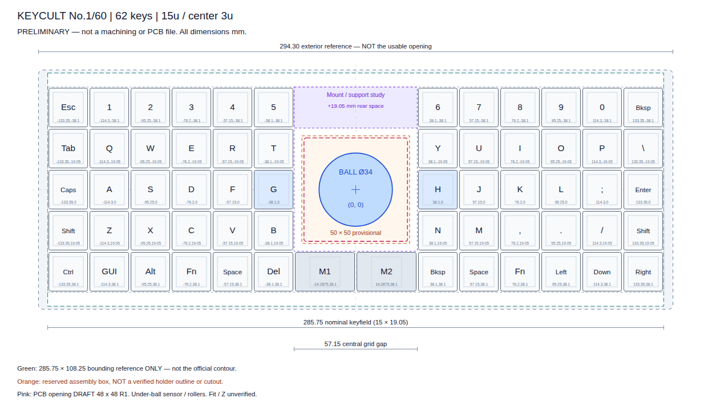
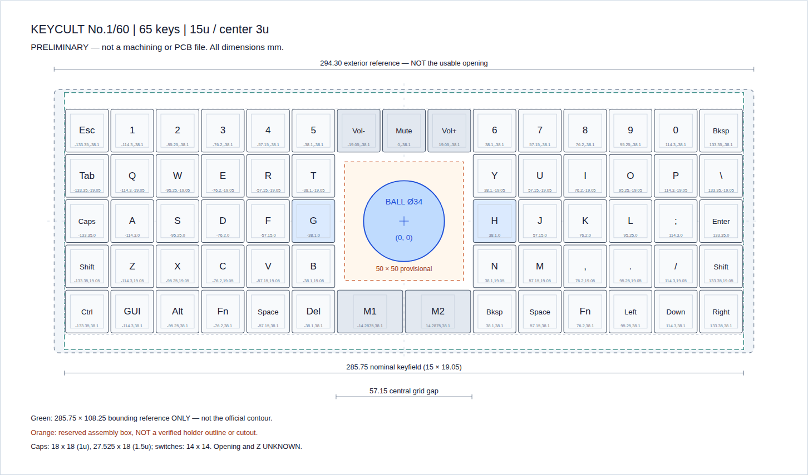

# keycult-ball

Keycult No.1/60의 기존 케이스를 가공하지 않고 PCB와 알루미늄 보강판을 교체해 G/H 사이에 34mm 트랙볼을 통합하는 개인 프로젝트입니다. 제작 시제품은 cocot36plus를 참고한 베어링 롤러와 수평 PMW3360 모듈, 62키 직교 배열을 사용합니다. 유선 USB에서 키보드와 포인팅 장치를 함께 처리하는 QMK 펌웨어를 빌드했으며 실물 동작은 아직 시험하지 않았습니다.

현재 개발 우선안은 **62키 배열과 알루미늄 보강판**입니다. 65키안은 비교용으로 유지합니다. 시제품은 1.5mm 6061-T6 알루미늄 판재와 버 제거를 선택하며 가공 공차와 실제 강성은 검증이 필요합니다. [중앙 PCB 개구 검토](design/preliminary/design.md#중앙-pcb-개구와-알루미늄-보강판)에서 제조 방식과 남은 설계 조건을 설명합니다.

[출력용 홀더 시제품](design/printable-holder/README.md)은 **PCB 아래 0.82mm까지만 공간이 있다는 가정**으로 설계합니다. 이는 짧은 Mill-Max 3305-0의 명목 돌출을 참고한 사용자 요청이며 실제 케이스 측정값이 아닙니다. 받침을 보강판 위에 놓고 센서를 올려, 나사까지 포함한 하부 돌출을 PCB 아래 0.4mm로 제한합니다. 볼 중심은 보강판 위 23.5mm, 위끝은 40.5mm이므로 높은 볼의 사용성은 출력 후 확인해야 합니다. 상부 링은 없으며 볼을 위로 들어낼 수 있습니다. [단면도](design/preliminary/section.png)와 [치수 근거](design/preliminary/sources/README.md#shallow-clearance-reference)를 함께 확인합니다.

62키 DRAFT H는 모든 실장 전자부품을 PCB 윗면으로 옮기고 중앙 뒤쪽에 MCU, 전원과 커넥터를 배치합니다. 48 x 48mm R1 중앙 PCB 개구, 36 x 36mm R3 보강판 창과 42mm 체결 피치를 사용합니다. [PCB 안내](design/pcb/README.md)의 Gerber, PTH/NPTH 드릴, BOM과 실장 좌표는 시제품 제작 검토용이며 [검증 보고서](design/pcb/62/reports/validation.json)와 같은 원본에서 생성합니다. [펌웨어 안내](firmware/README.md)에 실제 UF2 빌드 결과와 입력 기능, 재현 및 초기 전원 시험 조건이 있습니다. 출력물, 실제 센서, 케이블과 케이스를 함께 조립한 검증은 남아 있습니다.

보유 케이스는 NovelKeys 최신 판매 버전의 WK이며 정확한 리비전과 과거 공식 보강판 윤곽의 호환성은 확인이 필요합니다. 이번 시제품의 장치와 배열은 cocot 방식과 62키로 선택했습니다. [과거 대안 조사](docs/feasibility.md)는 참고 자료로 유지하며 실제 장착 공간을 대신하지 않습니다.

현재 홀더에 맞춘 보강판과 조립 CAD는 [홀더 안내](design/printable-holder/README.md)와 [재현 절차](docs/reproduction.md#출력용-독립-홀더-시제품)를 따릅니다. 공식 NoLeaf 외곽을 포함하는 STEP/DXF/FCStd는 `design/preliminary/sources/local/`에만 생성합니다. 공개 홀더 CAD의 직사각형 `CandidatePlate`는 실제 Keycult 가공용 보강판이 아닙니다. 이전 65키 및 깊은 62키 보강판 검토는 과거 비교용입니다.

[케이스를 포함한 FreeCAD 참조 모델](design/preliminary/design.md#케이스-참조-모델)은 기존 홀더 검토 사본에 공개 외장 치수와 가정한 내부 형상을 추가합니다. 65키와 62키의 반투명 전체 보기, 절개 보기와 객체별 간섭 결과를 로컬에 생성하며 [실행 방법](docs/reproduction.md#케이스-참조-형상을-포함한-freecad-검토)을 따릅니다. 실제 케이스 내부와 보강판 정렬은 실측하지 않았으므로 참조 모델의 간섭 결과를 실물 조립 판정으로 사용하지 않습니다.



## 현재 검토 중인 배치

우선안은 15u 너비의 5행 62키 배열이며, 중앙 3열의 위쪽 4행을 비워 트랙볼과 뒤쪽 센서 공간을 확보합니다. 하단 중앙은 1.5u M1/M2 두 키로 총 3u를 차지하며 M3 물리 키는 제거합니다. 실제 키캡과 스위치 조립 적합성은 미확정입니다. 아래 값은 현재 예비 설계의 계산값입니다.

| 항목 | 값 또는 조건 |
| --- | --- |
| 키 피치와 명목 키필드 | 19.05mm, 285.75 × 95.25mm |
| 볼과 G/H 키 중심 | 볼 `(0, 0)`, G `(-38.10, 0)`, H `(+38.10, 0)`, 단위 mm |
| 볼과 키캡 사이 최소 평면 간격 | 지름 34mm 볼과 1u 18 x 18mm, 1.5u 27.525 x 18mm 키캡 가정에서 12.10mm |
| 임시 조립 예약 영역 | 50 × 50mm, 키캡과 최소 4.10mm 간격 |
| 개발 우선안 | 15u 62키. 65키안의 상단 중앙 Vol-/Mute/Vol+를 제거해 중앙 명목 빈 영역을 57.15 × 76.20mm로 확장 |
| 보류한 대안 | 14u 너비의 64키 배열. 같은 예약 영역과 키캡이 5.425mm 겹침 |

62키안은 볼 지름 34mm와 중심, G/H 및 하단 1.5u M1/M2를 포함한 나머지 키를 유지합니다. 뒤쪽 한 행을 비워 센서와 배선, 지지 브리지와 체결 간격을 검토할 공간을 확보합니다. 키 제거만으로 강성이 좋아지는 것은 아니며, 빈 영역 전체를 절개하면 강성이 낮아질 수 있습니다. 볼 지름은 65키안과 같지만 현재 62키 홀더의 하부 센서 공간은 별도로 검토합니다.

KiCad 원본은 비교용 65키의 `design/pcb/keycult65.*`와 제작 시제품 62키의 `design/pcb/62/keycult62.*`로 나눕니다. 62키는 윗면 전자부품을 뒤쪽 중앙 빈 영역에 배치하며 중앙 개구에서 0.25mm 확장한 영역을 구리와 부품 금지 영역으로 사용합니다. 개구, 높이와 커넥터는 시제품 설계값이며 실제 센서 및 케이스와 대조해야 합니다. 키 좌표는 예비 배치, PCB와 펌웨어가 공유합니다.



50 × 50mm 영역은 실제 홀더 외곽이나 보강판 및 PCB의 가공 구멍 치수가 아닙니다. 공개 도면의 초록색 경계도 공식 보강판 윤곽을 복제한 것이 아니라, 전체 치수만 참조한 285.75 × 108.25mm 직사각형입니다. 현재 검증은 이 경계 안의 포함 여부와 부품 사이 평면 간격을 확인하며, 실제 케이스 개구부 통과나 수직 공간, 조립 가능 여부를 증명하지 않습니다.

## 자료 안내

| 자료 | 내용 |
|---|---|
| [프로젝트 맥락](docs/project-context.md) | 요구사항, 결정 이유, 확정/가정/미확정, 실측·다음 단계 |
| [KiCad 65키·62키 초안](design/pcb/README.md) | 각 배열의 편집 가능한 회로도·PCB, BOM·GPIO 맵, 실제 ERC/DRC·좌표 검증 및 PDF/SVG |
| [PCB 구현 계획](docs/pcb-implementation-plan.md) | 실측 전에 진행할 회로도·PCB 초안, 단계별 산출물과 제조 전 검증 |
| [62키 QMK 펌웨어](firmware/README.md) | 빌드한 UF2, 고정된 소스, 버튼과 스크롤 기능, 재현 및 초기 동작 시험 |
| [실현 가능성과 대안 조사](docs/feasibility.md) | 34mm 중앙 통합의 제약과 중앙에 통합할 소형 터치패드·트랙볼 비교 |
| [상세 설계와 출처](design/preliminary/design.md) | 치수 계산, 장착·flex, 센서 방향, QMK·USB 범위 |
| [Ploopy / Keyball / Charybdis 및 라이선스](docs/alternatives-and-licenses.md) | 제품별 차이, 원본 공개 범위와 재사용 조건 |
| [배치 HTML](design/preliminary/layout.html) · [SVG](design/preliminary/layout.svg) · [JSON](design/preliminary/layout.json) | 브라우저 설명도, 편집 가능한 벡터, 모든 키 중심 좌표 |
| [단면 SVG](design/preliminary/section.svg) · [PNG](design/preliminary/section.png) | 62키 하부 수평 센서와 미확정 Z 스택 |
| [1:1 A3 PDF](design/preliminary/print-1to1.pdf) · [SVG](design/preliminary/print-1to1.svg) | 100mm 기준선 포함 종이 검증용 |
| [62키 옵션 SVG](design/preliminary/rear-clearance.svg) · [PNG](design/preliminary/rear-clearance.png) · [1:1 A3 PDF](design/preliminary/rear-clearance-print.pdf) · [인쇄 SVG](design/preliminary/rear-clearance-print.svg) · [인쇄 HTML](design/preliminary/rear-clearance-print.html) | 뒤쪽 공간 확보 비교. 좌표는 `layout.json`의 `rear_clearance` |
| [재현·검증 방법](docs/reproduction.md) | 좌표 생성, PNG/PDF 렌더, 원본 취득·해시 검증 |
| [에이전트 작업 지침](AGENTS.md) | 설계 변경, 검증, 공개 자료 관리, 커밋·푸시 규칙 |

HTML은 저장소를 내려받은 뒤 브라우저에서 엽니다. GitHub에서는 위 PNG로 미리 볼 수 있습니다. 종이 배치는 A3 가로, 배율 100%, 페이지 맞춤을 끈 상태로 출력하고 100mm 기준선을 자로 확인합니다.

## 생성과 검증

Python 3.11 이상과 `uv`를 사용하며, 명령은 프로젝트 루트인 `workspace/keycult-trackball/`에서 실행합니다. 검증 및 렌더 스크립트의 의존성은 각 파일의 메타데이터에 고정되어 있고 `uv run`이 준비합니다.

기존 산출물과 문서의 로컬 링크를 검증하려면 다음 명령을 실행합니다.

```bash
uv run scripts/validate.py
```

배열이나 치수를 변경한 경우에는 산출물을 순서대로 다시 생성하고 검증합니다.

```bash
uv run design/preliminary/build_artifacts.py
uv run scripts/render.py
uv run scripts/validate.py
```

`design/preliminary/build_artifacts.py`의 배열과 치수 상수가 편집 원본이며, 키 중심 JSON과 SVG/HTML은 생성 결과입니다. 설계 변경은 생성기에 반영합니다. 생성기만 실행하면 기존 PNG/PDF는 갱신되지 않으므로 `scripts/render.py`도 실행해야 합니다. 렌더에는 시스템 Chromium이 필요하며, PATH에서 찾을 수 없으면 `KEYCULT_CHROMIUM`에 실행 파일의 절대 경로를 지정합니다.

검증 스크립트는 파일 형식과 로컬 링크, 키 개수와 좌표, 평면 간격, 직사각형 경계 안의 포함 여부, PDF의 A3 크기와 100mm 기준선을 검사합니다. 검증 결과 일부는 `envelope-containment.json`과 `print-validation.json`에 기록됩니다.

공식 윤곽 검사는 별도 절차입니다. 원본 사용 조건을 확인한 뒤 `uv run scripts/fetch_sources.py`로 원본을 취득하고 `uv run scripts/verify_official_contour.py`로 재현합니다. [과거 검사 기록](design/preliminary/plate-containment.json)은 현재 공개 검증으로 갱신되지 않습니다. 추출 좌표와 재검사 출력의 저장 위치, 해시 확인 방법은 [재현 문서](docs/reproduction.md)를 따릅니다.

## 시제품 제작과 조립 순서

친구에게 PLA/FDM 시험 출력을 부탁할 때는 [출력 요청 패키지](design/print-request/README.md)를 사용합니다. [전달용 ZIP](design/print-request/keycult-print-request-PLA.zip)에는 기존 홀더, 중앙 시험판과 받침대, 높이별 센서 스페이서, PCB 개구 더미, 수량표와 존댓말 메일 초안이 있습니다. STL 13종을 예비분 포함 24개 출력하며, 실제 케이스용 보강판이나 최종 PA12 부품을 대신하지 않습니다.

1. [홀더 패키지](design/printable-holder/holder-PROTOTYPE.zip)의 시험편을 먼저 출력해 구멍과 체결을 확인한 뒤 본체를 출력합니다. 34mm 볼과 베어링을 조립하고 높은 볼의 접근성과 회전을 확인합니다. 출력 재질과 공차, 나사 및 센서의 세부 조건은 홀더 안내를 따릅니다.
2. 로컬 보강판 CAD를 실제 보강판과 대조하고, 케이스 바닥까지의 거리와 커넥터 및 케이블 통로를 확인합니다. PCB 아래 0.82mm는 설계 가정입니다. 납땜부, 스위치 핀, 절연재와 휨을 포함한 실제 여유를 확인하며 깊은 이전 홀더 파일을 혼용하지 않습니다.
3. [62키 PCB 제작 검토 패키지](design/pcb/README.md)를 업체와 검토합니다. 4층 stackup, USB 배선, QFN 노출 패드와 비아 처리, 부품 번호와 실장 방향을 확정한 뒤 시제품을 제작합니다. 실제 센서가 조건부 +3V3 인터페이스와 일치하는지도 확인합니다.
4. 센서를 연결하기 전에 전원 단락, 3.3V 전원과 USB 열거, 62키 입력을 시험합니다. 센서의 리비전과 케이블 도통을 확인한 뒤 연결하고 렌즈 높이, 축 방향, 클릭과 스크롤, USB 재연결 및 발열을 시험합니다. [펌웨어 안내](firmware/README.md)의 전원과 SROM 한계를 따릅니다.

측정할 항목과 결정 이유는 [프로젝트 맥락](docs/project-context.md)에 기록합니다. 예비 SVG를 제조용 도면으로 사용하지 않습니다.

## 범위와 출처 관리

공개 자료는 독립 키 배열, 형상을 복제하지 않는 요약 측정값, 검증 결과, 출처 URL과 해시입니다. 제3자 STEP/DXF/Gerber 원본, 공식 보강판 윤곽 좌표와 이를 복제한 도면은 공개하지 않습니다. 원본 다운로드는 `design/preliminary/sources/upstream/`에, 상세 윤곽과 로컬 검사 결과는 `design/preliminary/sources/local/`에 저장하며 두 디렉토리는 Git에서 제외합니다. 원본 대화, 개인 메모, 인증 정보도 포함하지 않습니다.

저장소 공개 자체가 제3자 자료의 재사용이나 재배포 허가를 뜻하지 않습니다. 자료를 취득하거나 재사용하기 전에 [자료별 라이선스와 배포 범위](docs/alternatives-and-licenses.md), [출처와 측정 기록](design/preliminary/sources/README.md)을 확인합니다.
