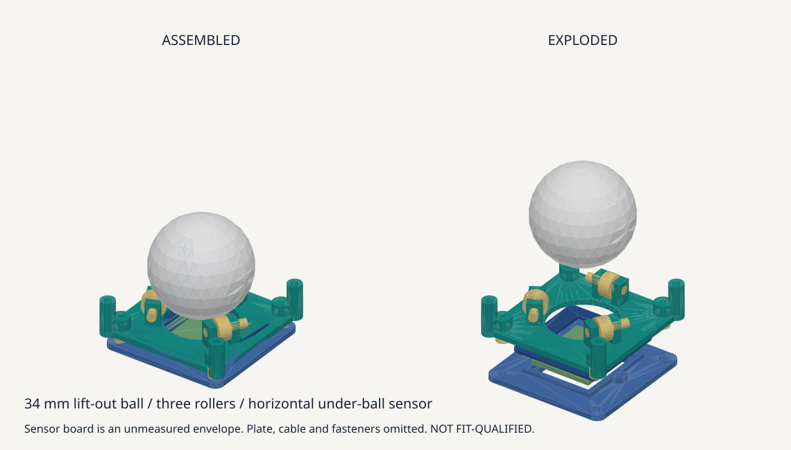

# 중앙 트랙볼 출력용 홀더 시제품

cocot36plus의 베어링 롤러와 볼 아래 수평 센서 배치를 참고한 독립 설계다. 34mm 볼, 62키 배열과 볼 중심 XY를 유지하고 상부 링과 스크롤 링은 사용하지 않는다. 보강판 위로 받침을 올려 하부 공간을 줄이며 실제 센서와 케이스를 측정하기 전의 출력 및 건식 조립 후보로 제공한다. cocot의 PCB나 원본 STEP 형상을 복제하지 않는다.



## 하부 공간과 광학 위치

단위는 mm다. 볼 중심 XY=(0,0), 보강판 윗면 Z=0, 뒤쪽=-Y다. 메인 PCB 윗면 -5, 두께 1.6, 아랫면 -6.6은 조립 가정이다. 사용자 요청에 따라 Mill-Max 3305-0의 명목 하부 돌출 0.82를 공간 기준으로 사용하여 바닥 한계를 Z=-7.42로 둔다. 실제 케이스 실측값이나 3306의 확인된 치수가 아니며 출처와 계산은 [프로젝트 맥락](../../docs/project-context.md)을 따른다.

| 항목 | 시제품 값 |
| --- | --- |
| 볼 | 지름 34, 중심 Z=23.5, 아래끝 6.5, 위끝 40.5 |
| 롤러 | 내경 3, 외경 8, 폭 4. DDR-830ZZ 규격 후보이며 구매품 실측값은 아님 |
| 롤러 축 | 방위각 90/210/330도, 수평 접선 방향. 중심 반경 14.849, Z=8.651 |
| 받침 바닥과 지지부 | 바닥 Z=1.5..3.5, 모서리 지지부는 Z=0부터 시작 |
| 센서 기판 가정 | 22 x 25 x 1.6, 아래면 -3, 위면 -1.4. 실제 U자형 기판, 렌즈, 부품과 커넥터를 복제한 모델은 아님 |
| 센서 지지대 | 외곽 36 x 36, 기본 아래면 -5 |
| 출력 부품의 최저점 | Z=-5 |
| 후보 나사 머리를 포함한 최저점 | Z=-7. 가정한 바닥까지 명목 간격 0.42 |
| 센서 높이 조절 | 위로 0..1.5. 아래로 내리는 조절은 허용하지 않음 |
| 보강판 체결 | (±21,±21), 42 정사각 피치, 지름 2.3 통과 구멍 |
| 센서 지지대 체결 | (±14,±14), 28 정사각 피치 |
| 메인 PCB 개구 | 48 x 48, 코너 R1. 실제 센서 적합성을 확정한 치수는 아님 |
| 보강판 후보 | 두께 1.5, 중앙 36 x 36 R3 개구. 뒤쪽 전자부품 창은 X=-28..28, Y=-47..-28, R1 |

볼이 보강판보다 40.5mm 높이 솟으므로 손가락 접근과 사용 자세를 출력 시제품으로 확인한다. 이 높이는 실제 센서의 광학 기준을 확인한 결과가 아니다. [PMW3360 데이터시트 v1.30 p.14](https://www.epsglobal.com/Media-Library/EPSGlobal/Products/files/pixart/PMW3360DM-T2QU.pdf?ext=.pdf)의 평면 표면에 대한 명목 거리 2.4를 적용하면 볼 아래끝 6.5에 대응하는 렌즈 기준면은 Z=4.1이다. 현재 센서 기판 윗면보다 5.5 높고 센서를 1.5 올리면 4.0 높다. 실제 모듈의 렌즈 기준면이 이 범위에 있는지 측정하고 곡면 볼의 추적 성능도 시험한다. PCB 면과 렌즈 기준면을 같은 면으로 취급하지 않는다.

## 파일과 출력 수량

[전체 패키지](holder-PROTOTYPE.zip)는 mm 단위 STL, 조립 STEP, FreeCAD, 미리보기, 검사 기록과 이 안내를 포함한다. STL은 각 부품의 최저면을 Z=0으로 옮겼으며 STEP과 FreeCAD는 조립 좌표를 사용한다.

| 파일 | 용도 | 출력 수량 |
| --- | --- | --- |
| [Cup-PROTOTYPE.stl](Cup-PROTOTYPE.stl) | 롤러 받침, 보강판 지지부와 센서 체결부 | 1 |
| [SensorCarriage-PROTOTYPE.stl](SensorCarriage-PROTOTYPE.stl) | 수평 센서 지지대 | 1 |
| [SensorCap-PROTOTYPE.stl](SensorCap-PROTOTYPE.stl) | 센서 가장자리 고정 덮개 | 1 |
| [SensorSpacer1-PROTOTYPE.stl](SensorSpacer1-PROTOTYPE.stl), [2](SensorSpacer2-PROTOTYPE.stl), [3](SensorSpacer3-PROTOTYPE.stl), [4](SensorSpacer4-PROTOTYPE.stl) | 동일한 4.5mm 센서 스페이서 | 각 1, 합계 4 |
| [SeatCoupon-PROTOTYPE.stl](SeatCoupon-PROTOTYPE.stl) | 축과 M2 구멍 시험편 | 1, 먼저 출력 |
| [holder-PROTOTYPE.step](holder-PROTOTYPE.step) | 시험편을 제외한 출력 부품 7개의 조립 위치 | 참조 |
| [holder-PROTOTYPE.FCStd](holder-PROTOTYPE.FCStd) | 출력 부품, 구매품 가정, 보강판과 PCB | 검토 |
| [checks.json](checks.json) | 입력 해시, 치수와 간섭 검사 | 검사 기록 |

FreeCAD의 `Ball`, `Roller*`, `Axle*`, `InnerSpacer*`, `*Screw*`, `*NutEnvelope*`, `SensorBoardAssumption`, `CandidatePlate`, `CurrentPCB`는 출력하지 않는다. 너트는 모서리를 감싸는 원통 외곽과 구멍으로 검사하며 나사산은 모델링하지 않는다. `CandidatePlate`는 공식 윤곽을 포함하지 않는 부분 참조다. 공식 외곽을 유지한 현재 보강판 STEP/DXF와 전체 FCStd/STEP은 Git에서 제외되는 `design/preliminary/sources/local/prototype-62/`에 생성한다. 과거 `plate-study/`, `holder-study/`, `case-study/`는 현재 조립체로 사용하지 않는다.

로컬 조립체는 부품 배치 manifest가 있으면 U1/U2/U3/J1/J2/Y1의 고정된 KiCad stock STEP을 포함한다. native KiCad의 6개 부품 STEP과도 형상을 대조하며, exporter가 부품에 추가하는 0.0012mm 높이 차이를 정규화한다. SW67/SW68의 stock 모델은 현재 STEP loader가 종료되는 문제가 있어 생략하고 검사 기록에 남긴다. 실제 공급 부품 치수와 나머지 전자부품의 전체 3D 간섭까지 검사한 것은 아니다.

편집 원본은 [홀더 생성기](../../scripts/build_printable_holder.py)와 [로컬 보강판 생성기](../../scripts/build_plate.py)다. FCStd 속성은 입력 기록이며 형상을 구동하지 않는다. 수동 수정본은 다른 이름으로 저장한다.

## 구매품과 체결 후보

| 부품 | 수량과 조건 |
| --- | --- |
| 트랙볼 | 지름 34, 1개 |
| 베어링 | 3 x 8 x 4, 3개 |
| 롤러 축 | M3x14 소켓 머리 나사와 M3 너트, 각 3개. 머리 지름 5.5, 높이 3, 너트 외곽 반경 3.2와 두께 2.4를 검사 |
| 내륜 스페이서 | 6개. 내경 3.1, 외경 4, 두께 0.3 후보. 실제 베어링 내륜에만 접촉하는지 확인 |
| 보강판 체결 | M2x8 소켓 머리 나사와 M2 너트 각 4개. 보강판 아래에서 위로 삽입 |
| 센서 지지대 체결 | 기본 M2x10 4개. 센서를 1.5 올리고 3mm 스페이서를 쓸 때 M2x8 4개 |
| 센서 덮개 체결 | M2x5 소켓 머리 나사 2개 |
| M2 머리 외곽 | 검사에 사용한 지름 3.8, 높이 2를 넘는 머리는 다시 검사 |
| 센서와 케이블 | 실제 PMW3360 모듈의 양쪽 핀맵, 전압과 커넥터 확인이 필요 |

M2 파일럿 지름 1.7은 나사산이 아니다. 출력 재료에서 탭 가공 또는 업체와 합의한 나사 체결 시험을 수행한다. 센서 지지대 나사의 명목 파일럿 체결 길이는 기본 3.5mm 이상이며 이는 자체 시제품 기준이다. 출력 재료의 인발 강도를 보증하지 않는다. 덮개 나사 끝은 지지대 아래로 0.2mm 나오지만 전체 최저점 -7보다 높다.

## 출력과 조립 순서

1. 시제품 출력 공정은 PA12 SLS/MJF, 배율 1:1로 선택한다. 보강판 후보는 1.5mm 6061-T6 알루미늄 판재이며 절삭 모서리의 버를 제거한다. 제조 가능성이나 강성 판정을 받은 선택은 아니므로 업체에 구멍과 절삭 공차 및 후가공을 확인한다. 시험편의 3.0/3.1/3.2mm 축 구멍과 1.7mm 파일럿, 2.3mm 통과 구멍을 먼저 출력하고 실제 나사와 축으로 검사한다. 전체 스케일로 끼워 맞추지 않는다.
2. 롤러 양쪽에 금속 내륜 스페이서를 넣고 M3 축을 고정한다. 외륜과 실드가 받침이나 스페이서에 닿지 않고 자유롭게 회전해야 한다. 과도한 조임으로 기둥을 휘게 하거나 베어링에 축방향 하중을 주지 않는다. 일반 M3 와셔가 외륜을 피한다고 가정하지 않는다.
3. 받침을 보강판 위에 올리고 M2x8을 아래에서 위로 삽입하여 위쪽 너트로 고정한다. 이 단계에서는 센서 지지대와 메인 PCB를 장착하지 않는다. 아래쪽 직선 공구 접근은 이 조립 순서로 확보한다.
4. 실제 센서의 기판 외곽, U자형 절개, 렌즈 기준면, 부품과 케이블을 측정한다. 지지대와 덮개의 약 1mm 가장자리 접촉 영역에 부품이나 노출 도체가 있으면 먼저 형상을 수정한다. 얇은 절연 패드로 XY와 상하 유격을 없애되 기판이나 렌즈를 휘게 누르지 않는다. 센서 기판과 광학 중심이 같다는 가정도 확인한다.
5. 센서와 덮개를 아래에서 중앙 개구에 넣고 네 4.5mm 스페이서와 M2x10으로 받침에 고정한다. 덮개는 보강판 높이를 통과하므로 원형 지름 36 창을 대신 사용하지 않는다. 받침 바닥의 두 지름 4.4 관통 릴리프는 덮개 머리와 공구를 위한 공간이다. 볼을 뺀 상태에서 위로부터 접근한다.
6. 메인 PCB를 아래에서 조립체로 올려 48 x 48 R1 개구 안에 센서 지지대를 넣는다. 케이블은 임시로 분리하고 부품과 납땜 접합부가 다른 부품을 긁지 않는지 확인한다. 키 스위치와 케이스의 실제 조립 순서는 사용 부품의 체결 구조와 대조한다.
7. 렌즈 기준면을 측정한 뒤 네 스페이서를 같은 양만큼 줄여 센서를 위로만 조절한다. 기본 4.5mm에서 최대 3mm까지다. 3mm 스페이서에는 M2x8을 사용한다. 중간 높이는 나사 길이와 파일럿 체결 길이를 확인한다. 기본 위치보다 아래로 내리면 하부 공간 조건을 다시 설계해야 한다.
8. 볼을 세 롤러에 얹고 플라스틱 접촉 없이 회전하는지 확인한다. 상부 링이 없으므로 위로 들어낼 수 있다. 키보드를 뒤집기 전에 볼을 뺀다. 받침과 센서를 함께 잠근 상태에서 케이블 여유, 저속 및 고속 추적과 재연결을 시험한다. [센서 인터페이스 안내](../pcb/README.md#sensor-interface-remains-unresolved)의 조건을 따른다.

## 재현과 검사 범위

[재현 절차](../../docs/reproduction.md#출력용-독립-홀더-시제품)에 따라 설치된 FreeCAD와 호환되는 Python을 사용한다.

```bash
uv run --python /Applications/FreeCAD.app/Contents/Resources/bin/python scripts/build_printable_holder.py
uv run --python /Applications/FreeCAD.app/Contents/Resources/bin/python scripts/build_plate.py
```

검사는 단일 솔리드, STL 폐곡면과 연결 성분, STL 부피 오차 0.5% 미만, STEP 부피 오차 1ppm 이하와 FCStd 재열기를 포함한다. 출력 부품과 후보 하드웨어, 검증된 PCB 외곽, 후보 보강판 및 키캡과 스위치 가정 사이의 명목 간섭을 확인한다. M2 파일럿 안의 의도한 나사 체결만 간섭에서 제외한다. 센서를 위로 0/0.75/1.5 이동하고 볼의 수직 분리, 아래에서의 센서와 PCB 삽입, 반경 1.5 공구 축의 롤러 및 덮개 접근을 검사한다. 실제 공구 손잡이와 케이스 안에서의 접근은 검사하지 않는다.

바닥 검사는 홀더, 후보 나사, 센서 기판 가정과 메인 PCB의 판재에만 적용한다. 스위치 금속 핀과 플라스틱 돌기, Mill-Max 소켓과 납땜 접합부는 모델링하지 않았으므로 기판 전체가 0.82mm 하부 공간에 들어간다는 판정이 아니다. 실제 스위치와 소켓 조립체의 최저점을 별도로 확인한다.

바닥 여유 0.42는 출력 공차, PCB 휨, 실제 나사 머리, 납땜, 케이블, 절연과 케이스 공차를 포함하지 않는다. 실제 센서 광학 위치, 구매품 치수, 케이스 수납, 강성, 출력 공차, 전원과 추적 성능은 실물 검증이 필요하다. 주문, 업로드와 케이스 가공은 수행하지 않는다.
